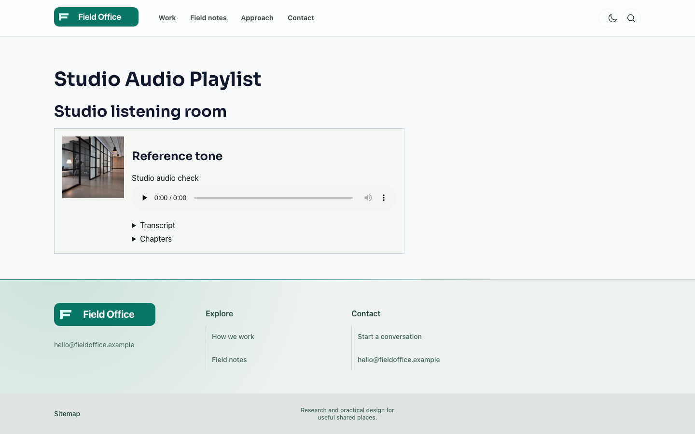
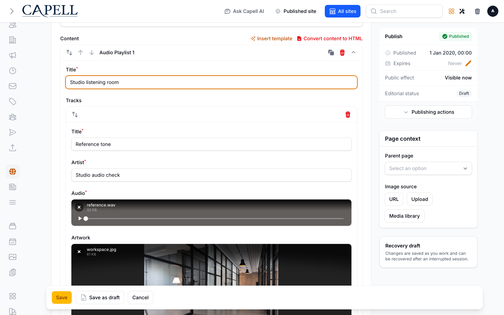

# Audio Playlist Widget

<!-- prettier-ignore-start -->

Recordings of your talks, sermons or podcast episodes go on your own page as an audio playlist. Listeners see them listed in the order you choose and play each one right there in the browser.

The files have to be ones you upload, which means a Spotify or SoundCloud link won't work here. Each track gets a title and an artist, plus a picture if you want one. Paste in a written version of a talk and listeners can open it under a Transcript heading.

Chapters let people skip to the part they came for. Give each part of a recording a name and the time it starts, and it shows as a button such as "Sermon (08:40)". Tapping it jumps the track to that point and plays from there.

No audio downloads until someone presses play, which keeps the page quick to open. Tracks don't run on from one to the next, and starting a second track pauses the first.

- **Price and availability:** Check current availability and price on the [Capell Marketplace listing](https://capell.app/extensions/widget-audio-playlist).
- **Licence:** Check the licence terms on the [Capell Marketplace listing](https://capell.app/extensions/widget-audio-playlist).
- **Requires:** `PHP ^8.4`, `capell-app/admin ^1.0`, `capell-app/core ^1.0.66`, `capell-app/frontend ^1.0`, `capell-app/layout-builder ^1.0.44`, `spatie/laravel-package-tools ^1.0`.
- **Install:** `composer require capell-app/widget-audio-playlist`.

## Quick Start

1. Install the package: `composer require capell-app/widget-audio-playlist`.
2. Open a page, click **Layout builder**, **Add widgets**, then choose **Audio Playlist**.

## For Developers

The package registers a typed widget extension and validates media and nested track data before the public Blade render.

## Configure

This extension works without configuration. There is nothing to set after install.

## Limits And Pitfalls

- Install the required Capell packages at the versions in `composer.json`: `capell-app/admin ^1.0`, `capell-app/core ^1.0.66`, `capell-app/frontend ^1.0`, `capell-app/layout-builder ^1.0.44`.
- Keep public Blade and cached HTML free of authoring markers, model IDs, permissions, signed editor URLs, and lazy database queries.
- Custom write integrations must preserve invalidation for `widget-audio-playlist` cache tags.

## Screens And Workflow

- Audio Playlist Widget extension card (marketplace).
- Audio Playlist fields in Layout Builder (admin).
- Audio Playlist public output (frontend).
- Audio Playlist fields in Layout Builder with admin sidebar menu open (admin).

## Install Impact

- Required packages: `capell-app/admin`, `capell-app/core`, `capell-app/frontend`, `capell-app/layout-builder`.
- Admin navigation: no admin page or resource contribution is declared.
- Admin/editor extensions: `content-widget: WidgetAudioPlaylistContribution`.
- Permissions: no package permission declarations or Shield gates detected; host access rules still apply.
- Public routes: none declared.
- Database changes: no package migrations declared.
- Config: no package config files.
- Settings: no package settings declared.
- Queues or schedules: none declared.
- Cache tags: `widget-audio-playlist`.
- Commands: none declared.

## Troubleshooting

| Symptom | Likely cause | Check | Fix |
| --- | --- | --- | --- |
| Package surface is missing after install | Provider or manifest is not loaded | Confirm `capell.json`, package `composer.json`, and provider registration | Reinstall the package, refresh Composer autoload, and clear host caches |
| Public output leaks unexpected state | Render data, cache variation, or authoring boundary has regressed | Check public Blade, cache tags, and public-output safety tests | Move data loading out of Blade and rerun the package public-output tests |

## Upgrading

No manual steps between minor versions.

## Next Steps

- [Package docs](docs/README.md)
- [Overview](docs/overview.md)
- [Troubleshooting](#troubleshooting)
- [Developer reference](docs/reference.md)
- [Marketplace assets](docs/assets/marketplace/)
- [Capell content language plan](../../docs/CONTENT_LANGUAGE_PLAN.md)
- [Capell documentation design system](../../docs/DESIGN_SYSTEM.md)
- [Capell and package ERD notes](../../docs/erd/capell-and-package-erds.md)
- Related packages: [Layout Builder](../layout-builder/README.md).

<!-- prettier-ignore-end -->
